## UIII Act6 Preparación y evaluación de imágenes para Visión Artificial
### Alexandro Aguilar NC 0007
## Imagenes originales de gatos + en terminal 0007
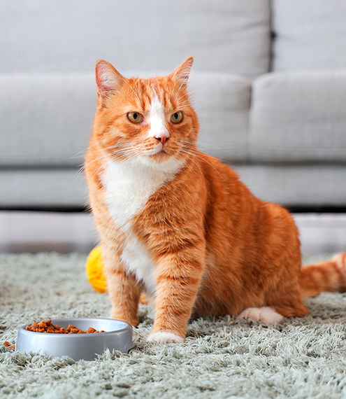, , 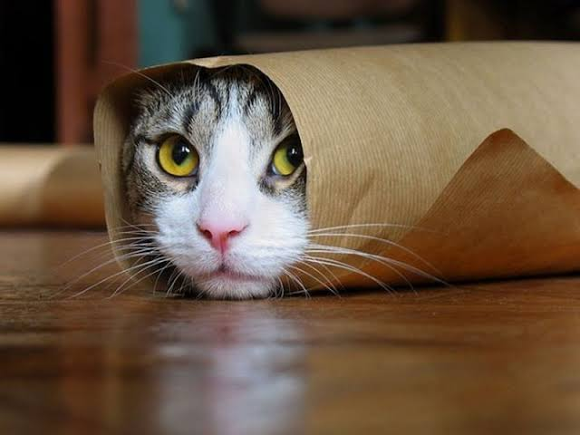, 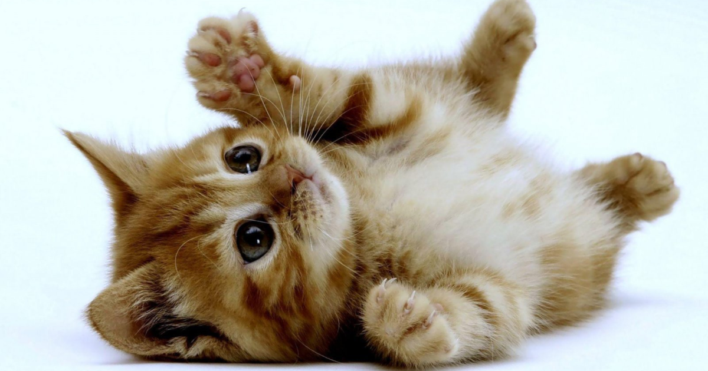, 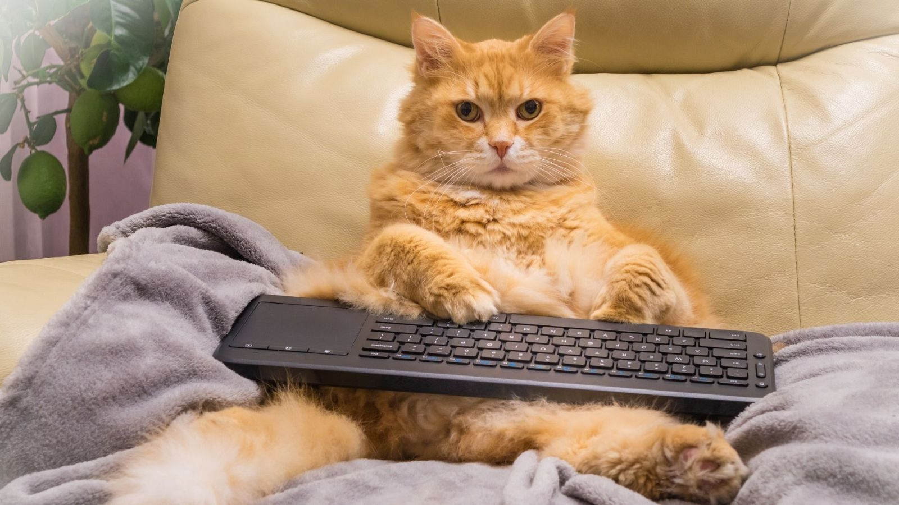
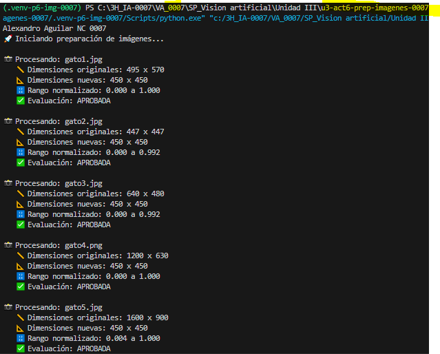
## Imagenes originales de perros + en terminal 0007
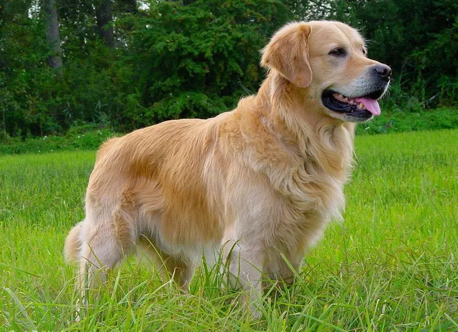, , 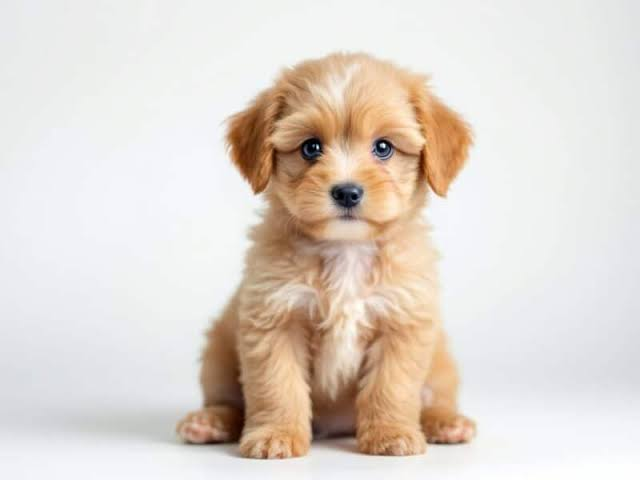, 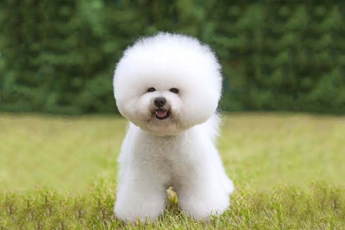, 
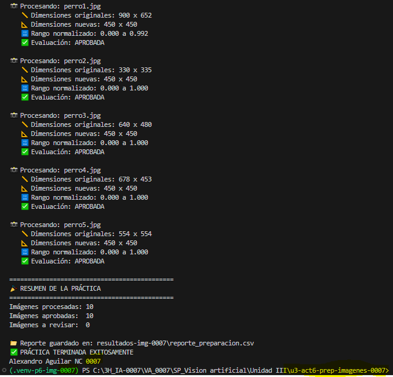
## imagenes preparadas gatos 0007

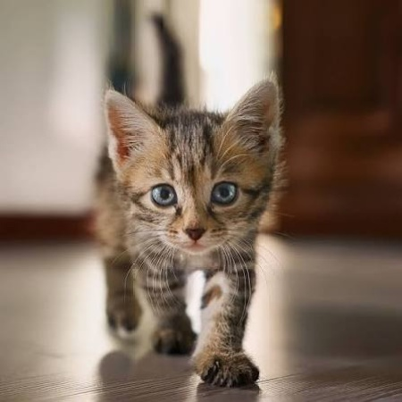

## imagenes preparadas perros 0007

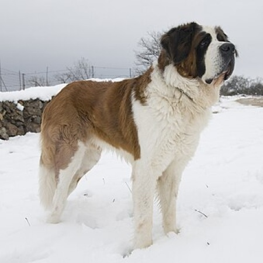

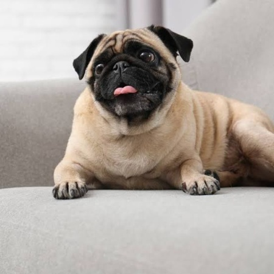

